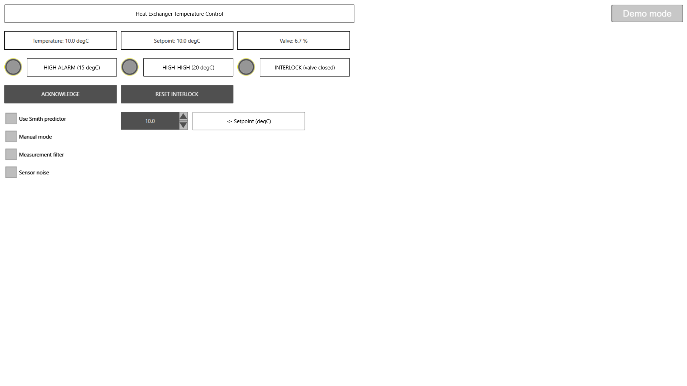
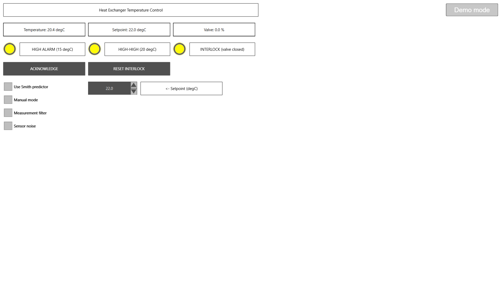
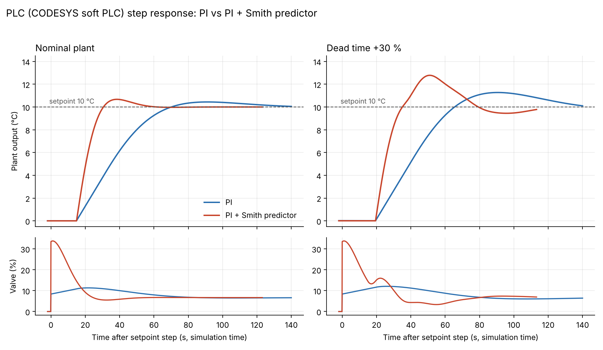

# Heat Exchanger Temperature Control on a PLC (CODESYS)

PLC implementation and validation of a heat exchanger temperature loop with long dead time.
Two controllers run on a CODESYS soft PLC: a **PI** controller and a **PI + Smith predictor**.
The PLC results are checked against the MATLAB design from Project 1
([Heat-Exchanger-Smith-Predictor-matlab](https://github.com/anjanamahi011/Heat-Exchanger-Smith-Predictor-matlab)).

The program also has a measurement filter, auto/manual modes, alarms (high, high-high, sensor fault),
a latching safety interlock, and a web operator screen.

## What is in this project

| Part | What it does |
|---|---|
| `FB_PlantSim` | Simulated heat exchanger: gain 1.5 °C/%, time constant 50 s, dead time 15 s (delay buffer), sensor lag 5 s, optional measurement noise (about 0.05 °C), plant gain and dead-time change factors, disturbance input |
| `FB_PI` | PI controller with 0-100 % output limits, anti-windup (the integral stops growing while the output is saturated) and tracking of a manual value for bumpless switching |
| `FB_SmithPredictor` | Smith predictor model: plant lag and sensor lag, run once without delay and once with the 15 s delay. The difference is fed back into the PI error |
| `FB_TempControl` | Runs two PI controllers (plain PI and PI for the Smith loop), selects one, handles auto/manual mode, and adds an optional first-order measurement filter (2 s) |
| `FB_Alarm` | High (15 °C) and high-high (20 °C) alarms with 2 s on-delay and 0.5 °C deadband, sensor fault check, acknowledge, latched interlock with operator reset |
| `PLC_PRG` | Main program, 100 ms cyclic task, connects everything |
| `Visu` | Web operator screen: live values, alarm lamps, acknowledge and reset buttons, setpoint spin box, controller / mode / filter / noise switches |

Controller tuning (from the MATLAB design):

| Controller | Kc (% per °C) | Ti (s) |
|---|---|---|
| PI | 0.834 | 50 |
| PI with Smith predictor | 3.336 | 50 |

## Operator screen

Normal operation:

High-high alarm with the interlock holding the valve closed (valve = 0 %):

## Results: PLC vs MATLAB

Setpoint step of 10 °C. The numbers are measured on the true plant output (before the sensor lag).

| Case | Overshoot (MATLAB / PLC) | Settling time, 5 % band (MATLAB / PLC) | IAE (MATLAB / PLC) |
|---|---|---|---|
| PI, nominal plant | 4.39 % / 4.41 % | 63.0 s / 62.7 s | 388.0 / 385.8 |
| PI + Smith, nominal plant | 6.78 % / 6.73 % | 45.5 s / 44.8 s | 221.9 / 221.1 |
| PI, dead time +30 % | 12.68 % / 12.72 % | 124 s / 123.6 s | 468.7 / 459.5 |
| PI + Smith, dead time +30 % | 27.83 % / 27.81 % | 102.5 s / 101.7 s | 342.3 / 336.2 |

What this shows:
- Overshoot and settling time on the PLC match MATLAB within about 1 %.
- With the nominal model the Smith predictor settles about 28 % faster than PI (44.8 s vs 62.7 s) and cuts IAE by about 43 %.
- With a 30 % dead-time error the Smith predictor is still faster, but its overshoot (27.8 %) is much higher than PI (12.7 %).
  The Smith loop is more sensitive to model mismatch with this tuning. The two controllers were not tuned for equal robustness.

## Alarm and interlock tests (on the running PLC)

| Test | Result |
|---|---|
| Setpoint 17 °C: high alarm after temperature passes 15 °C (2 s delay) | Pass |
| Acknowledge: alarm state goes from 1 (active, unacknowledged) to 2 (active, acknowledged) | Pass |
| Setpoint 22 °C: high-high alarm at 20 °C, interlock latches, valve forced to 0 % | Pass |
| A new alarm while another is already acknowledged is announced again (state back to 1) | Pass (fixed during testing) |
| Reset after temperature is below 15 °C: interlock released, valve control resumes | Pass |
| Sensor fault (reading below -5 °C or above 60 °C) | Not tested on the PLC, checked by code review only |

## How to run it

1. Install CODESYS V3.5 SP22 (with the CODESYS Control Win V3 x64 soft PLC package).
2. Open `HeatExchanger_PLC_Control.project`.
3. Start **CODESYS Control Win** (keep its console window open). Demo mode runs for about 2 hours per start.
4. In the project: double-click **Device**, **Scan Network**, select the PLC. Then **Login with download** and press F5.
5. Open `http://localhost:8080/webvisu.htm` in a browser for the operator screen.

`HeatExchanger_PLC_Control.xml` has the program code (all function blocks and `PLC_PRG`) as PLCopen XML, so the code can be read without CODESYS. The operator screen is stored only in the `.project` file.
The four `.csv` files (`pi_nominal`, `pi_delay30`, `smith_nominal`, `smith_delay30`) are the raw trace recordings used for the results table.
The design report is `PLC_Heat_Exchanger_Control_Design_Report.docx`.

## Limitations

- **Simulated plant.** The heat exchanger is simulated inside the PLC. There is no real I/O.
- **Scan time.** The soft PLC runs on Windows, so the actual scan period was about 108 ms (median) instead of 100 ms.
  The plant model uses a fixed step of 0.1 s, so all metrics are computed in simulation time. In wall-clock time the responses look about 8 % slower.
- **IAE windows differ.** MATLAB integrates 800 s. The PLC recordings were shorter (about 113 s to 144 s after the step), so PLC IAE values are slightly lower.
- **Cases not repeated on the PLC:** gain +30 %, gain -30 %, dead time -30 %. These were only run in MATLAB.
- **One-scan lag.** The Smith predictor error uses a one-scan-old model value.
- **Not matched for robustness.** PI and PI + Smith were not tuned to the same sensitivity peak (Ms).
- **Alarm handling is basic.** There is no time-stamped alarm history, and no trend on the operator screen. Trend curves come from the CODESYS Trace tool.
- **Sensor fault** logic was not tested on the running PLC.

## Tools

CODESYS V3.5 SP22 Patch 4, CODESYS Control Win V3 x64, Structured Text, CODESYS WebVisu, MATLAB (design and comparison data).

*Author: Anjana Mahendran, M.Tech Instrumentation & Control Engineering, CUSAT.*
